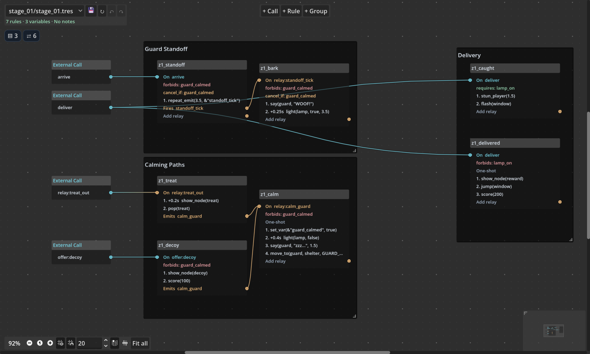
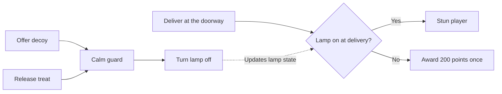
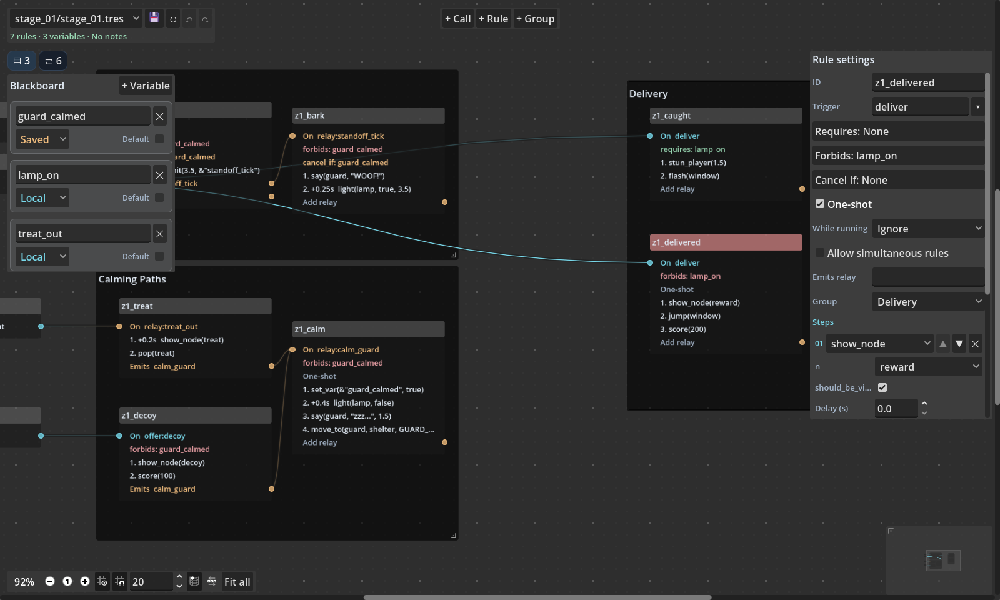
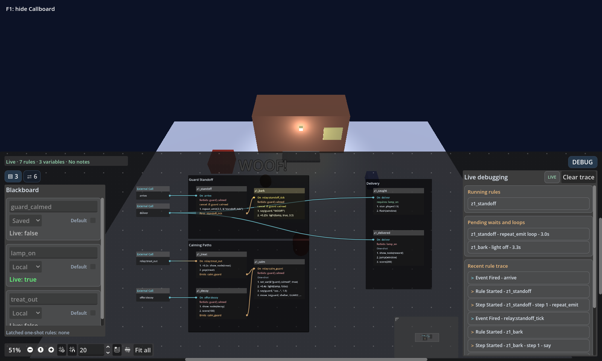
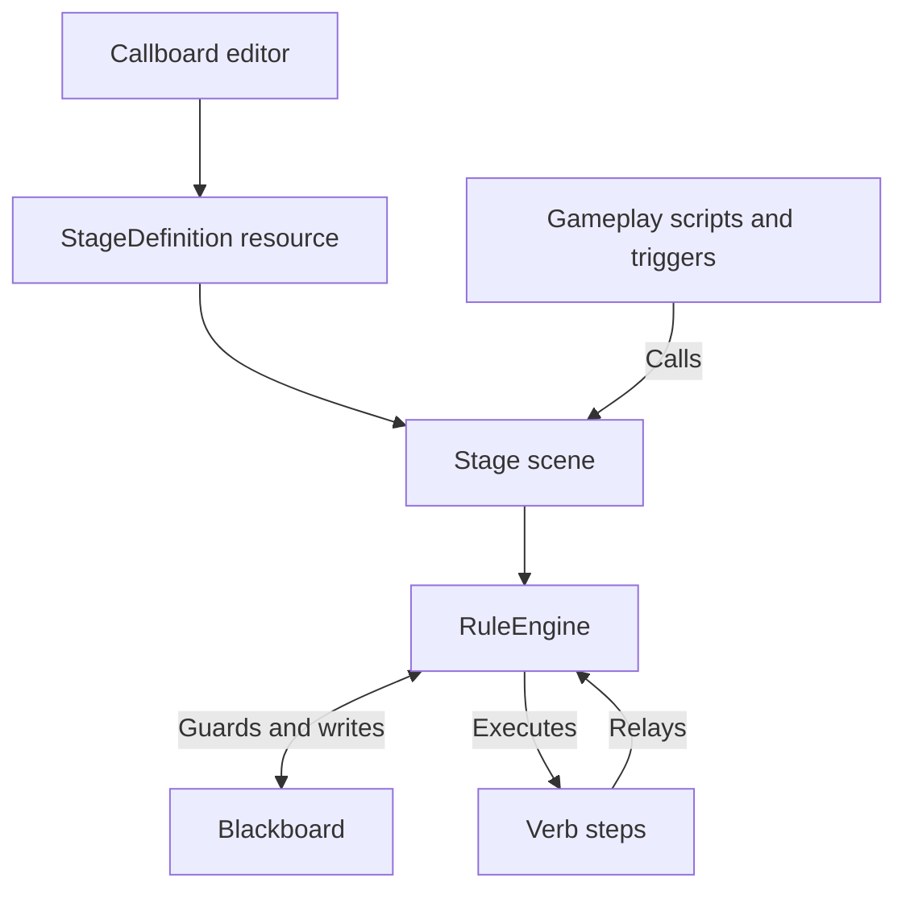

# Callboard

**Choreograph event-driven gameplay in Godot.** Callboard is a visual rule editor and GDScript runtime for 3D scenes. Define what can happen, which conditions must be true, and what runs next in a Stage graph. Your gameplay code supplies events and actions. Callboard handles the sequencing, state checks, and relays between rules.

[Download](https://github.com/chrisnathan1983/director_blackboard_demo_4/releases/latest) · [Run the demo](#run-the-demo) · [Install](#install-in-your-project) · [Author a stage](#author-a-stage) · [Live debugging](#live-debugging) · [API reference](docs/api.md)

[](https://github.com/chrisnathan1983/director_blackboard_demo_4/actions/workflows/test.yml)
**Godot 4.7** · **GDScript** · **[0BSD](LICENSE)**



*Stage 01 in the Callboard authoring workspace. Follow the wires from a Call through the rules and relays it can trigger.*

## Run the demo

Open [project.godot](project.godot) in Godot **4.7** and press **F5**. The plugin is already enabled. Open the **Callboard** editor tab and select `stage_01/stage_01.tres` to inspect the same rules that drive the demo. The project includes `res://demo/stages` in `callboard/stage_scan_folders` so the stage picker can find it. CI uses Godot **4.7.2**.

1. Walk toward the doorway. The guard barks and the lamp flashes. Interact while the lamp is on to see the caught rule.
2. Interact by the red shelter to offer a decoy, or walk into the blue pad to release a treat. Either path calms the guard.
3. Return to the doorway with the lamp off and interact to collect the delivery reward.

| Control | Action |
| --- | --- |
| **WASD** or **arrow keys** | Move |
| **E** | Interact |
| **F1** | Toggle the live Callboard |
| **R** | Reload the Stage and reset local variables |
| **X** | Clear saved variables, one-shot latches, and score, then reload |



The two calming paths emit the same `calm_guard` relay. The two delivery rules share the `deliver` Call and use opposite checks on `lamp_on`.

Open [Stage 01’s scene](demo/stages/stage_01/stage_01.tscn) to inspect the placed props. Select the Stage root to see the guard and lamp assignments. Select **DeliveryArea** or **DecoyArea** to see which Call each area fires. The [annotated stage script](demo/stages/stage_01/stage_01.gd) shows how to expose these scene nodes to the graph and how to build the treat and decoy in code from scene markers.

Press **F1** during play and open **DEBUG** to follow a Call through its rules, waits, and relays. After delivering, press **R** to see the saved guard state and one-shot delivery latch restore the scene. Press **X** to start fresh.

## Install in your project

1. Download `callboard-<version>.zip` from the **Assets** section of the [latest release](https://github.com/chrisnathan1983/director_blackboard_demo_4/releases/latest). Extract it beside your `project.godot` file to install `addons/callboard/`.
2. Open **Project → Project Settings → Plugins** and enable **Callboard**.
3. Choose **Project → Tools → Create New Stage...**. The generator creates a scene, a GDScript extending `Stage`, and an assigned `StageDefinition` resource under the configured Callboard stages directory (default `res://stages/`). In **Project Settings → General → Callboard**, set **Default Stage Folder** to choose where new stages are saved. Add folders under **Stage Scan Folders** to discover stages elsewhere. Callboard scans the default folder and all listed folders recursively.
4. Open the **Callboard** tab and select your new definition. Instance the generated scene in your game and call `activate()` after it has entered the scene tree.

See [Godot's plugin installation guide](https://docs.godotengine.org/en/stable/tutorials/plugins/editor/installing_plugins.html) for the editor settings.

## Author a Stage

A **Stage** is a `Node3D` scene with a **StageDefinition** resource. The resource holds event declarations, Blackboard variables, rules, ordered steps, and graph layout. The scene supplies actors and props.

| On the board | In the game |
| --- | --- |
| **Call** | An event fired by gameplay, such as `deliver`. `activate()` fires `arrive`. |
| **Blackboard** | Typed state read by rules and written by steps or gameplay. Local values reset on reload. Saved values use a dictionary supplied by your game. |
| **Trigger** | The event ID a rule listens for, such as the Call `deliver` or the relay `relay:calm_guard`. |
| **Rule** | An ordered sequence of steps with a trigger, optional guards, and an optional completion relay. |
| **Guard** | A Blackboard check used by Requires, Forbids, or Cancel If. |
| **Verb** | A GDScript factory method, such as `set_var`, that builds a step. |
| **Step** | One use of a verb with its own arguments and optional delay. |
| **Relay** | A named event, usually emitted by a rule or step. Enter the bare name `calm_guard` when configuring a rule's output. Its listeners use `relay:calm_guard` as the trigger. |

### Build your first rule

1. In a new Stage, open **Blackboard** and add a local `bool` named `door_open` with a default of `false`.
2. Add a Call named `open_door`. Add a rule and wire the Call to its trigger, or choose `open_door` in **Rule Settings**.
3. Set **Forbids** to `door_open`. Add a `set_var` step with arguments `&"door_open"` and `true`, then save.
4. From an interaction handler, send the Call to your initialized Stage.

```gdscript
func on_door_interacted(stage: Stage) -> void:
	stage.fire(&"open_door")
	print(stage.get_var(&"door_open"))  # true
```

Add a `show_node` or `move_to` step to make a scene prop respond. Step arguments can reference typed Stage props and script constants. The API reference includes [a custom verb you can add to the picker](docs/api.md#custom-verbs).

<details>
<summary>See the Blackboard and Rule settings</summary>



</details>

### Control when a rule runs

| Setting | Behavior |
| --- | --- |
| **Requires** | Every listed guard must pass when the rule is considered. Bare keys use truthiness; numeric comparisons such as `score >= 10` work with `int` and `float` keys. |
| **Forbids** | Any passing guard blocks the start. A comparison such as `heat < 2.5` can be forbidden just like a truthy key. |
| **Cancel If** | Any passing guard cancels the run at a cancellation check, including before the first step and after a delay or awaited step. |
| **One-shot** | Latches when the rule starts. The latch survives reloads when your game reuses the `fired` dictionary. |
| **While running** | Sets the rule's re-entry policy. **Ignore** drops another trigger during a run. **Restart** keeps the newest eligible payload and replaces the run at a cancellation check. **Queue** retains eligible payloads in arrival order and rechecks guards before each run. One-shot rules use **Ignore**. |
| **Expect shared-trigger overlap** | Suppresses the validation warning when this rule and another rule listening to the same event may both run. |

### Edit and rename authored data

Use **Calls & relays** to manage connections. Renaming updates authored references. Update event IDs in gameplay code and scene triggers separately. Blackboard renames preserve aliases for existing gameplay references.

Select a rule to edit its guards, steps, and relay. Rule renames preserve saved one-shot latches. Pass the current rule ID to `Stage.has_fired()`. Use the toolbar to save, reload, undo, or redo. Validation checks step expressions and surfaces issues such as relay cycles and overlapping guards.

The diagnostics menu shows separate **Error** and **Warning** entries. Select an entry to jump to its rule when one is identified. Errors block saving or activation. Warnings identify issues to review and allow saving.

Use **Compact** in the graph toolbar to switch to minimized nodes. The title bar shows the rule name; a single row below it shows colored icons for Requires, Forbids, Cancel If, steps, delays, and one-shot state, plus the emitted relay name. Hover an icon or relay name for details. The trigger input and relay output ports sit at the row's left and right edges. If a rule emits multiple relays, choose one from the popup when wiring from compact view.

To add a numeric guard, enter a comparison such as `score >= 10` below Requires, Forbids, or Cancel If and press **Add**. Supported operators are `>`, `>=`, `<`, `<=`, `==`, and `!=`; comparisons accept only declared `int` and `float` Blackboard keys.

## Live debugging



Press **F1** in the demo to inspect the running Stage. The **DEBUG** panel shows active rules, queued or restarting runs, pending waits, and recent event and step activity. Open **Blackboard** to inspect current values or **Calls & relays** to fire a declared Call while testing. The live graph uses the loaded Stage definition and highlights rules as they run.

Use `CallboardDebugPanel.create()` to add the live board to your own HUD. See [Embedding the live debugger](docs/api.md#embedding-the-live-debugger).

To see a cancellation, start with a fresh Stage, wait for a guard tick, then offer the decoy. The trace shows the calming relay and the guard loop stopping at its next cancellation check.

## How it fits together



The editor writes a `.tres` file that the Stage compiles into runtime rules. The export plugin excludes addon tests from exports and strips the editor and authoring model from release exports. See the [API reference](docs/api.md) for Stage lifecycle, persistence, signals, built-in verbs, and runtime diagnostics.

## Develop and test

| Path | Contents |
| --- | --- |
| [`addons/callboard/core/`](addons/callboard/core/) | Stage, Blackboard, rule execution, validation, and verbs |
| [`addons/callboard/editor/`](addons/callboard/editor/) and [`model/`](addons/callboard/model/) | Authoring UI, live board, and graph tooling |
| [`demo/`](demo/) | Demo game scene, scripts, and sample Stage |
| [`addons/callboard/tests/`](addons/callboard/tests/) | Addon unit tests, editor smoke tests, and fixtures |
| [`demo/tests/`](demo/tests/) | Editor and runtime smoke tests that exercise the demo |

```sh
godot --headless --path . --import
godot --headless --path . --script res://addons/callboard/tests/unit.gd
godot --headless --path . --script res://addons/callboard/tests/editor_smoke.gd
godot --headless --path . --script res://demo/tests/editor_smoke.gd
godot --headless --path . --script res://demo/tests/smoke.gd
```

[GitHub Actions](.github/workflows/test.yml) runs the four suites separately and checks that the demo runtime works without the editor and authoring model.

### Releases and PR builds

After all tests pass, a default-branch run publishes the addon ZIP to [GitHub Releases](https://github.com/chrisnathan1983/director_blackboard_demo_4/releases). To try a pull request, open its **Checks** tab, then follow **Package Callboard** to the workflow run and download the ZIP from the run summary or **Artifacts**.

The workflow adds its run number to the patch number in `plugin.cfg`. PR builds append `-pr.<number>`, and reruns reuse the same version. Version numbers can skip when a run fails or builds a preview. Each ZIP contains the installable addon and its license.

If a Windows headless import reports `Safe save failed` in a restricted workspace, use a writable workspace or disable **Filesystem → On Save → Safe Save On Backup Then Rename** in a dedicated test editor profile. The setting is in Godot’s **Editor Settings**.

## AI disclosure

I developed Callboard through vibe coding from start to finish. I directed the project and used ChatGPT (Codex) as my primary assistant for writing the code and carrying out project tasks. GitHub Copilot occasionally helped with coding. I also consulted Claude and Google Gemini for direction and feedback.

## License

Callboard, formerly Director Blackboard / Rule Board, is released under the [Zero-Clause BSD License](LICENSE).
