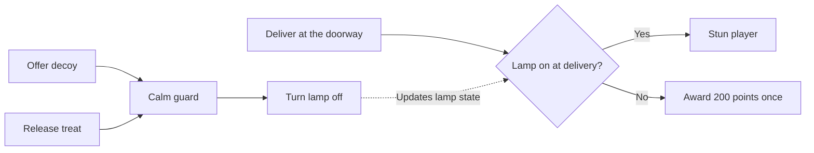
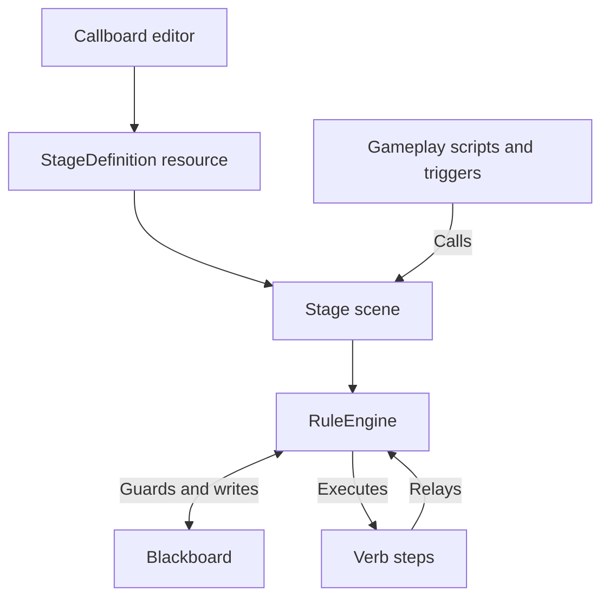

# Callboard

**Choreograph event-driven gameplay in Godot.** Callboard is a visual rule editor and GDScript runtime for 3D scenes. Define what can happen, which conditions must be true, and what runs next in a Stage graph. Your gameplay code supplies events and actions. Callboard handles the sequencing, state checks, and relays between rules.

[Run the demo](#run-the-demo) · [Install](#install-in-your-project) · [Author a stage](#author-a-stage) · [Live debugging](#live-debugging) · [API reference](docs/api.md)

[](https://github.com/chrisnathan1983/director_blackboard_demo_4/actions/workflows/test.yml)
**Godot 4.7** · **GDScript** · **[0BSD](LICENSE)**


*Stage 01 in the Callboard authoring workspace. Follow the wires from a Call through the rules and relays it can trigger.*

## Run the demo

Open [project.godot](project.godot) in Godot **4.7** and press **F5**. The plugin is already enabled. Open the **Callboard** editor tab and select `stage_01/stage_01.tres` to inspect the same rules that drive the demo. CI uses Godot **4.7.2**.

1. Walk toward the doorway. The guard barks and the lamp flashes. Interact while the lamp is on to see the caught rule.
2. Interact by the red shelter to offer a decoy, or walk into the blue pad to release a treat. Either path calms the guard.
3. Return to the doorway with the lamp off and interact to collect the delivery reward.

| Control | Action |
| --- | --- |
| **WASD** or **arrow keys** | Move |
| **E** | Interact |
| **F1** | Toggle the live Callboard |
| **R** | Reload the Stage and reset local variables |
| **X** | Clear saved variables, one-shot latches, and score, then reload |



The two calming paths emit the same `calm_guard` relay. The two delivery rules share the `deliver` Call and use opposite checks on `lamp_on`.

## Install in your project

1. Copy [`addons/callboard/`](addons/callboard/) into your project's `addons/` directory.
2. Open **Project → Project Settings → Plugins** and enable **Callboard**.
3. Choose **Project → Tools → Create New Stage…**. The generator creates a scene, a GDScript extending `Stage`, and an assigned `StageDefinition` resource under `res://stages/`.
4. Open the **Callboard** tab and select your new definition. Instance the generated scene in your game and call `activate()` after it has entered the scene tree.

See [Godot's plugin installation guide](https://docs.godotengine.org/en/stable/tutorials/plugins/editor/installing_plugins.html) for the editor settings.

## Author a Stage

A **Stage** is a `Node3D` scene with a **StageDefinition** resource. The resource holds Calls, Blackboard variables, rules, ordered steps, and graph layout. The scene supplies actors and props.

| On the board | In the game |
| --- | --- |
| **Call** | An event fired by gameplay, such as `deliver`. `activate()` fires `arrive`. |
| **Blackboard** | Typed state read by rules and written by steps or gameplay. Local values reset on reload. Saved values use a dictionary supplied by your game. |
| **Rule** | A response to a Call or relay. Its guards decide whether it can start. |
| **Step** | An action built by a GDScript verb, optionally preceded by a delay. |
| **Relay** | A named event emitted by a rule or step. Listeners use a trigger such as `relay:calm_guard`. |

### Build your first rule

1. In a new Stage, open **Blackboard** and add a local `bool` named `door_open` with a default of `false`.
2. Add a Call named `open_door`. Add a rule and wire the Call to its trigger, or choose `open_door` in **Rule settings**.
3. Set **Forbids** to `door_open`. Add a `set_var` step with arguments `&"door_open"` and `true`, then save.
4. From an interaction handler, send the Call to your initialized Stage.

```gdscript
func on_door_interacted(stage: Stage) -> void:
	stage.fire(&"open_door")
	print(stage.get_var(&"door_open"))  # true
```

Add a `show_node` or `move_to` step to make a scene prop respond. Step arguments can reference typed Stage props and script constants. The API reference includes [a custom verb you can add to the picker](docs/api.md#custom-verbs).

<details>
<summary>See the Blackboard and Rule settings</summary>


</details>

### Control when a rule runs

| Setting | Behavior |
| --- | --- |
| **Requires** | Every listed key must be truthy when the rule is considered. |
| **Forbids** | Any truthy listed key blocks the start. |
| **Cancel If** | Any truthy listed key cancels the run at a cancellation check, such as after a delay or awaited step. |
| **One-shot** | Latches when the rule starts. The latch survives reloads when your game reuses the `fired` dictionary. |
| **Re-entry** | **Ignore** drops another trigger during a run. **Restart** keeps the newest payload and replaces the run at a cancellation check. **Queue** retains payloads in arrival order and rechecks guards before each run. One-shot rules use **Ignore**. |

Use **Calls & relays** to manage connections. Renaming updates authored references. Update Call names in gameplay code and scene triggers separately. Blackboard renames preserve aliases for existing gameplay references. Select a rule to edit its guards, steps, and relay. Use the toolbar to save, reload, undo, or redo. Validation checks step expressions and surfaces issues such as relay cycles and overlapping guards.

## Live debugging


Press **F1** in the demo to inspect the running Stage. The **DEBUG** panel shows active rules, queued or restarting runs, pending waits, and recent event and step activity. Open **Blackboard** to inspect current values or **Calls & relays** to fire a declared Call while testing. The live graph uses the loaded Stage definition and highlights rules as they run.

To see a cancellation, start with a fresh Stage, wait for a guard tick, then offer the decoy. The trace shows the calming relay and the guard loop stopping at its next cancellation check.

## How it fits together



The editor writes a `.tres` file that the Stage compiles into runtime rules. The export plugin strips the editor and authoring model from release exports. The demo HUD loads the live board only in debug builds. See the [API reference](docs/api.md) for Stage lifecycle, persistence, signals, built-in verbs, and runtime diagnostics.

## Develop and test

| Path | Contents |
| --- | --- |
| [`addons/callboard/core/`](addons/callboard/core/) | Stage, Blackboard, rule execution, validation, and verbs |
| [`addons/callboard/editor/`](addons/callboard/editor/) and [`model/`](addons/callboard/model/) | Authoring UI, live board, and graph tooling |
| [`stages/stage_01/`](stages/stage_01/) and [`scripts/`](scripts/) | Sample Stage and demo game |
| [`tests/`](tests/) | Unit, editor smoke, and runtime smoke tests |

```sh
godot --headless --path . --import
godot --headless --path . --script res://tests/unit.gd
godot --headless --path . --script res://tests/editor_smoke.gd
godot --headless --path . --script res://tests/smoke.gd
```

[GitHub Actions](.github/workflows/test.yml) runs the three suites separately and checks that the demo runtime works without the editor and authoring model.

## License

Callboard, formerly Director Blackboard / Rule Board, is released under the [Zero-Clause BSD License](LICENSE).
