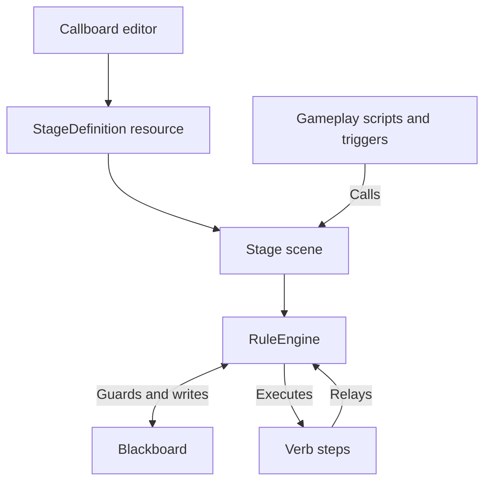

# Callboard

**Choreograph event-driven gameplay in Godot.** Callboard is a visual rule editor and GDScript runtime for 3D scenes. Define what can happen, which conditions must be true, and what runs next in a Stage graph. Your gameplay code supplies events and actions. Callboard handles the sequencing, state checks, and relays between rules.

[Download](https://github.com/chrisnathan1983/director_blackboard_demo_4/releases/latest) · [Install](#install-in-your-project) · [Author a Stage](#author-a-stage) · [Live debugging](#live-debugging) · [API reference](docs/api.md)

**Godot 4.7** · **GDScript** · **[0BSD](../../LICENSE)**

## Install in your project

1. Download `callboard-<version>.zip` from the **Assets** section of the [latest release](https://github.com/chrisnathan1983/director_blackboard_demo_4/releases/latest). Extract it beside your `project.godot` file to install `addons/callboard/`.
2. Open **Project → Project Settings → Plugins** and enable **Callboard**.
3. Choose **Project → Tools → Create New Stage...**. The generator creates a scene, a GDScript extending `Stage`, and an assigned `StageDefinition` resource under the configured Callboard stages directory (default `res://stages/`). In **Project Settings → General → Callboard**, set **Default Stage Folder** to choose where new stages are saved. Add folders under **Stage Scan Folders** to discover stages elsewhere. Callboard scans the default folder and all listed folders recursively.
4. Open the **Callboard** tab and select your new definition. Instance the generated scene in your game and call `activate()` after it has entered the scene tree.

See [Godot's plugin installation guide](https://docs.godotengine.org/en/stable/tutorials/plugins/editor/installing_plugins.html) for the editor settings.

## Author a Stage

A **Stage** is a `Node3D` scene with a **StageDefinition** resource. The resource holds event declarations, Blackboard variables, rules, ordered steps, and graph layout. The scene supplies actors and props.

| On the board | In the game |
| --- | --- |
| **Call** | An event fired by gameplay, such as `deliver`. `activate()` fires `arrive`. |
| **Blackboard** | Typed state read by rules and written by steps or gameplay. Local values reset on reload. Saved values use a dictionary supplied by your game. |
| **Trigger** | The event ID a rule listens for, such as the Call `deliver` or the relay `relay:calm_guard`. |
| **Rule** | An ordered sequence of steps with a trigger, optional guards, and an optional completion relay. |
| **Guard** | A Blackboard or incoming payload check used by Requires, Forbids, or Cancel If. |
| **Verb** | A GDScript factory method, such as `set_var`, that builds a step. |
| **Step** | One use of a verb with its own arguments and optional delay. |
| **Relay** | A named event, usually emitted by a rule or step. Enter the bare name `calm_guard` when configuring a rule's output. Its listeners use `relay:calm_guard` as the trigger. |

### Build your first rule

1. In a new Stage, open **Blackboard** and add a local `bool` named `door_open` with a default of `false`.
2. Add a Call named `open_door`. Add a rule and wire the Call to its trigger, or choose `open_door` in **Rule Settings**.
3. Set **Forbids** to `door_open`. Add a `set_var` step with arguments `&"door_open"` and `true`, then save.
4. From an interaction handler, send the Call to your initialized Stage.

```gdscript
func on_door_interacted(stage: Stage) -> void:
	stage.fire(&"open_door")
	print(stage.get_var(&"door_open"))  # true
```

Add a `show_node` or `move_to` step to make a scene prop respond. Step arguments can reference typed Stage props and script constants. The API reference includes [a custom verb you can add to the picker](docs/api.md#custom-verbs).

### Contextual interactions

Use `InteractionResolver` to choose one prompt and one interactable trigger from an actor's overlapping `TriggerArea`s. Set each INTERACT area's `prompt_text`, optional `prompt_icon`, and `interaction_priority`. The resolver selects by priority, distance, then node path, and refreshes as the actor or host state changes.

```gdscript
resolver.prompt_changed.connect(_show_prompt) # text, icon, priority
resolver.interact({"source": "inventory_ui"})

trigger.set_eligibility_hook(func(actor: Node) -> bool:
    return inventory.has("permit")
)
trigger.set_interaction_handler(func(actor: Node, context: Dictionary) -> Dictionary:
    inventory.erase("permit")
    return {"accepted": true, "payload": {"accepted": true}}
)
```

The host's eligibility hook decides whether an option is offered. Its interaction handler decides acceptance, performs any inventory policy, and supplies the Call payload. Accepted outcomes dispatch `event`; rejected outcomes can dispatch `rejected_event`. See the [TriggerArea and InteractionResolver API](docs/api.md#triggerarea) for setup and signals.

### Control when a rule runs

| Setting | Behavior |
| --- | --- |
| **Requires** | Every listed guard must pass when the rule is considered. Bare keys use Blackboard truthiness; comparisons can use Blackboard keys or fields from the incoming payload. |
| **Forbids** | Any passing guard blocks the start. Payload comparisons and presence checks work here too. |
| **Cancel If** | Any passing guard cancels the run at a cancellation check, including before the first step and after a delay or awaited step. Payload guards use that run's original payload. |
| **One-shot** | Latches when the rule starts. The latch survives reloads when your game reuses the `fired` dictionary. |
| **While running** | Sets the rule's re-entry policy. **Ignore** drops another trigger during a run. **Restart** keeps the newest eligible payload and replaces the run at a cancellation check. **Queue** retains eligible payloads in arrival order and rechecks guards before each run. One-shot rules use **Ignore**. |
| **Expect shared-trigger overlap** | Suppresses the validation warning when this rule and another rule listening to the same event may both run. |

### Edit and rename authored data

Use **Calls & relays** to manage connections. Renaming updates authored references. Update event IDs in gameplay code and scene triggers separately. Blackboard renames preserve aliases for existing gameplay references.

Use **Focus** in the graph toolbar to search for a Call or relay. A Call shows its listeners. A relay shows the rules that emit it, including step emissions, and its listeners. **Highlight** dims the rest of the board, while **Isolate** hides unrelated cards and wires. **Fit focus** frames the matching cards. Use the clear button next to **Focus** to return to the full board. Focus is also available on the live board.

Select a rule to edit its guards, steps, and relay. Rule renames preserve saved one-shot latches. Pass the current rule ID to `Stage.has_fired()`. Use the toolbar to save, reload, undo, or redo. Validation checks step expressions and surfaces issues such as relay cycles and overlapping guards.

The diagnostics menu shows separate **Error** and **Warning** entries. Select an entry to jump to its rule when one is identified. Errors block saving or activation. Warnings identify issues to review and allow saving.

Use **Compact** in the graph toolbar to switch to minimized nodes. The title bar shows the rule name; a single row below it shows colored icons for Requires, Forbids, Cancel If, steps, delays, and one-shot state, plus the emitted relay name. Hover an icon or relay name for details. The trigger input and relay output ports sit at the row's left and right edges. If a rule emits multiple relays, choose one from the popup when wiring from compact view.

To declare payload fields, select a rule and add fields under **Payload fields for [trigger]** in the inspector. Field names must be identifiers and field types are `bool`, `int`, `float`, or `String`. Schema declarations apply to Calls and relays. A call site can send a dictionary with `Stage.fire(&"interact", {"action": "confirm"})`.

Use expressions such as `payload.action == "confirm"`, `payload.accepted == true`, or `payload.count >= 3` in Requires, Forbids, and Cancel If. Use `has(payload.item)` or `missing(payload.item)` when a rule should handle an absent field. Missing or type-incompatible values fail comparisons, including `!=`. Bare names such as `door_open` continue to refer to Blackboard keys. The inspector lists trigger fields and guard payload references separately; validation checks field names and operand types against the selected trigger's schema.

Use the built-in `add_var` step to update numeric Blackboard counters. It reads the current value when it runs, so multiple Calls accumulate and later steps see the new value. Integer keys accept whole-number positive or negative deltas; float keys accept fractional deltas. Saved counters continue from the values in your Stage's injected save dictionary.

### Declare gameplay Blackboard writers

Use `StageDefinition.external_writers` to declare outputs supplied by gameplay. Each `BlackboardWriterData` names a Blackboard key, a source label, and the output type. The editor treats these as producers when checking guards and reports undeclared keys or type mismatches. Existing `external_vars` entries remain supported as anonymous producers.

For scene components, add a `BlackboardWriter` node and fill its `callboard_writers` list. Call `publish(key, value)` for continuous values or discrete state changes; the write goes through `Stage.write_var()` and the live Blackboard view shows the source label. A custom Stage can instead override `_declare_external_writers()` and call `register_external_writer()`. `fire_relay_once()` also records its `source_id` as the latch writer. Use Calls for discrete events that should start rules; use Blackboard writes for current state that guards should observe.

For a saved per-gift flag, a `GiftTarget` can declare its output on the Stage and write through the typed wrapper:

```gdscript
func _declare_external_writers() -> void:
    register_external_writer(&"delivered_robot", &"gift_target:robot", "bool")

func mark_delivered() -> void:
    write_var(&"delivered_robot", true, &"gift_target:robot")
```

Define `delivered_robot` as a saved Boolean in the Blackboard. Pair it with a saved `gifts_delivered` counter and the graph's `add_var` step when a house needs aggregate completion progress.

### Persist and stream Stage instances

Use `StageStateStore` when several instances of a Stage scene need independent saved values and one-shot latches. Give each loaded plot a stable ID, such as `house_01_left` and `house_01_right`; the state store injects its dictionaries before the Stage initializes.

```gdscript
var state_store := StageStateStore.new()

func load_plot(scene: PackedScene, plot_id: StringName) -> Stage:
    return state_store.load_stage(scene, plot_id, self) # Dormant when managed_lifecycle is enabled.

func enter_plot(stage: Stage) -> void:
    stage.activate()

func leave_plot(stage: Stage) -> void:
    state_store.unload_stage(stage)
```

Set `StageDefinition.managed_lifecycle` for streamed yards. A managed Stage builds and restores while dormant, ignores Calls until `activate()`, fires `arrive` on entry, and cancels active rules on `deactivate()` or unload. `TriggerArea` and `InteractionResolver` filter prompts from dormant Stages. Existing projects can keep injecting `saved_vars` and `fired` dictionaries directly.

Blackboard variables can use **Local**, **Saved**, or **Shared** scope. Shared keys use the same `state_key` and type across loaded Stages; writes update all matching boards. The store reports schema conflicts and rejects a write that would violate another loaded Stage's type. Save the `StageStateStore` resource or serialize its dictionaries with a Variant-preserving format if the game needs disk persistence.

Add `StageRestorationBinding` resources to a StageDefinition for resolved visuals. A Boolean binding can set a node's visibility or snap a `Node3D` to a `Marker3D`, with an optional `AnimationPlayer` pose. A saved `Transform3D` can restore a prop directly. Bindings run after the Stage's `_restore_state()` hook and before activation; paths, node types, and animation names are validated during Callboard analysis. For multiple gifts, keep a saved Boolean per gift, have each target reject an already delivered flag, and increment a saved counter with `add_var`. This restores each visual independently while keeping aggregate completion guards simple.

The built-in staging verbs include timed `light`, audio playback, rotation, `AnimationPlayer` playback and posing, material-safe `flash`/`jump`, and `gameplay_event`. Waiting options are explicit for audio, rotation, and animation playback; those waits are released when a Stage deactivates. Connect to `stage.gameplay_event` to handle authored IDs and argument dictionaries in your game. Existing `stage.scored` and `score(points)` behavior remains available. See the [Staging verbs API](docs/api.md#built-in-verbs) for parameter and validation details.

To add a Blackboard numeric guard, enter a comparison such as `score >= 10` below Requires, Forbids, or Cancel If and press **Add**. Supported operators are `>`, `>=`, `<`, `<=`, `==`, and `!=`.

## Live debugging

Use `CallboardDebugPanel.create()` to add a live board to your HUD, then bind the active Stage. The **DEBUG** panel shows active rules, queued or restarting runs, pending waits, and recent event and step activity. Open **Blackboard** to inspect current values and writer labels, or **Calls & relays** to fire a declared Call. See [Embedding the live debugger](docs/api.md#embedding-the-live-debugger).

## How it fits together



The editor writes a `.tres` file that the Stage compiles into runtime rules. The export plugin excludes addon tests from exports and strips the editor and authoring model from release exports. See the [API reference](docs/api.md) for Stage lifecycle, persistence, signals, built-in verbs, and runtime diagnostics.

## AI disclosure

I developed Callboard through vibe coding from start to finish. I directed the project and used ChatGPT (Codex) as my primary assistant for writing the code and carrying out project tasks. GitHub Copilot occasionally helped with coding. I also consulted Claude and Google Gemini for direction and feedback.

## License

Callboard, formerly Director Blackboard / Rule Board, is released under the [Zero-Clause BSD License](../../LICENSE).
