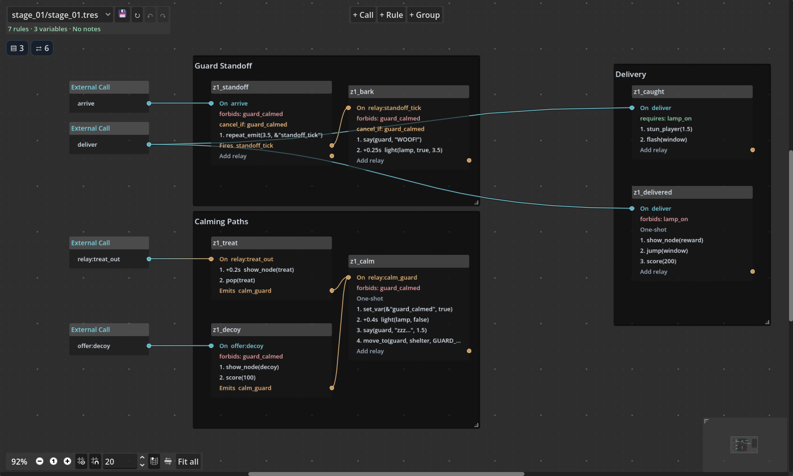
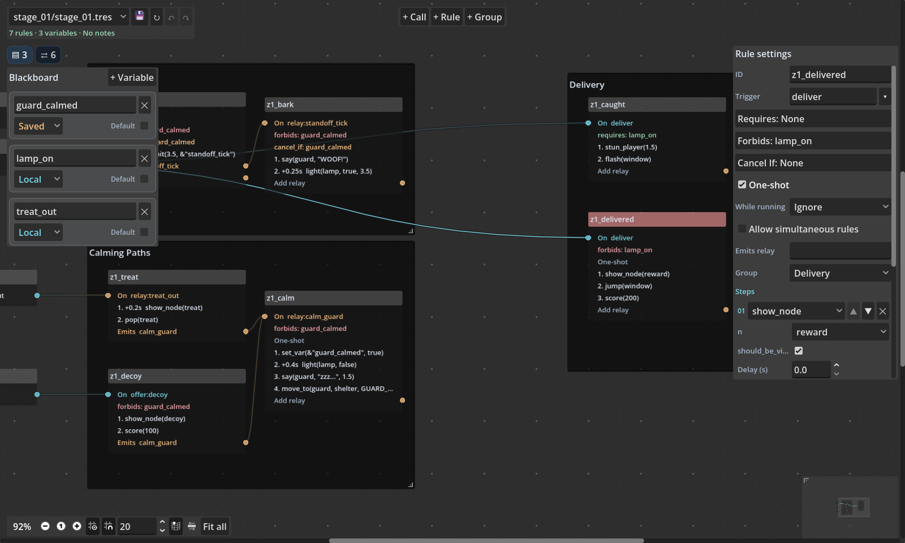
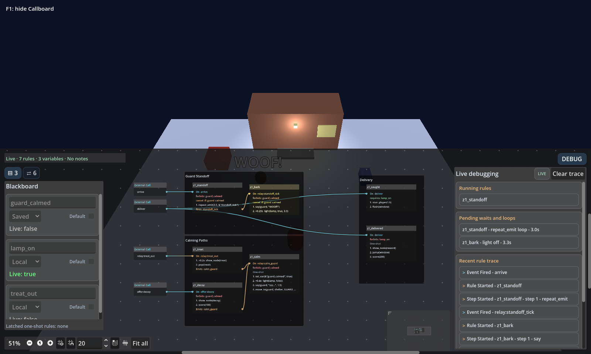

# The Duck Stops Here

## Run the demo

Open [project.godot](../project.godot) in Godot **4.7** and press **F5**. The plugin is already enabled. Open the **Callboard** editor tab and select `stage_01/stage_01.tres` to inspect the same rules that drive the demo. The project includes `res://demo/stages` in `callboard/stage_scan_folders` so the stage picker can find it. CI uses Godot **4.7.2**.

City Hall is expecting a rubber duck, Inspector Biscuit is taking his job very seriously, and the clerk requires a permit for indoor quacking.

The opening frames City Hall, cuts closer to Inspector Biscuit, and pulls back to the gameplay view. Movement and interaction unlock when that view returns. **Reload** and **Switch office** can interrupt the opening. It plays once when you launch the demo.

1. Offer a decoy at the red shelter or step on the blue biscuit pad to get Inspector Biscuit off duty.
2. Get a squeak permit at the yellow desk. You can do this before or after distracting the inspector.
3. Deliver the duck at City Hall to earn 200 points and meet the new deputy. Try the door early to see what the clerk says when the inspection lamp is on, the inspector is still on duty, or the permit is missing.
4. Stay at the door and deliver the desk bell when its prompt takes over. Watch the camera move in for the bell, shake as it settles, pull back to frame both gifts, then return to gameplay. Try **Reload** between deliveries to see the duck and the count of one restored while the bell is still available. Reload during the close-up to interrupt it and see the final bell pose restored.
5. Choose **Switch office** to visit the annex. It uses the same scene with its own permit, deliveries, and one-shot rules. The **Citywide** total carries across both offices.

## Try the dispatch desk

Walk to the teal **Dispatch desk** on the left of the plaza. Interact once to prepare a parcel, then again within six seconds to confirm. The parcel arcs toward City Hall while the beacon flickers and the stamp sounds. Interact again during launch to cancel, or leave the confirmation prompt unanswered to see the timeout. Open the live **DEBUG** panel to follow each wait and branch.

Dispatches go standard by default. With the permit stamped or Biscuit off duty, the desk sends express if the inspection lamp is off. The HUD counts completed dispatches across reloads and office switches. **Start fresh** clears the session count.

| Example | Where to follow it |
| --- | --- |
| Named states, first-match routing, and dynamic prompts | In [Stage 01](stages/stage_01/stage_01.tres), select `dispatch:desk` and inspect the **Dispatch desk** group. Ordered rules prepare, confirm, or cancel based on `dispatch_state`. Its `on_change` rule adjusts the beacon, and the [Stage script](stages/stage_01/stage_01.gd) uses the same state to choose the prompt. |
| Cross-Stage events, relay field mapping, and typed inputs | `dispatch_start` sends `records:file` to the separately authored [City Records Stage](stages/city_records/city_records.tres). Records broadcasts the typed receipt back to the active office. `dispatch_receive` maps `service` to `route`, and `dispatch_route` writes that payload field to the Blackboard. |
| Cancellable waits and host acknowledgment | `dispatch_start` waits for the confirmation relay and the returned route. The [game manager](scripts/game_manager.gd) acknowledges the correlated stamp request with a typed response. Cancel during launch to see the parallel branches stop, or leave the desk awaiting confirmation to see the recovery relay. |
| Conditional, parallel, and seeded random groups | The guard on the service branch selects standard or express. A joined group moves the parcel along a path, restarts particles, flickers the beacon, and plays the pitched stamp. A seeded weighted choice picks the closing line after the branches finish. |
| Session state and authoring diagnostics | Inspect the **Session** scope of `dispatch_count`. Open **City Records** in Callboard and check **Diagnostics** for the `file_first_dispatch` objective, the Call that reaches it, and its dependency on cross-Stage delivery. In the live office board, `records:receipt` has a typed `service` field you can fill in. |
| Localization | Run the project with Godot's `--language fr` option to see the dispatch prompts and receipt lines in French. The [dispatch catalog](stages/stage_01/dispatch.fr.po) supplies translations, and the receipt line substitutes the route at runtime. |

## Controls

| Touch or mouse | Keyboard | Action |
| --- | --- | --- |
| Drag anywhere in the play area | **WASD** or **arrow keys** | Move |
| Tap the action button when it appears | **E** | Interact with a nearby prop |
| Tap **Callboard** | **F1** | Toggle the live Callboard when available |
| Tap **Reload** | **R** | Reload the Stage and reset local variables |
| Tap **Switch office** | — | Switch between City Hall and the annex |
| Tap **Start fresh** | **X** | Reset both offices, the shared delivery total, the dispatch session, and the score |

The movement stick appears under your finger or mouse and follows as you drag. After your first drag, the stick hides whenever you release it. On a touchscreen, hold the stick with one finger and tap the bottom-center action button with another.

Select `give:gift` and toggle **Isolate** in Callboard to follow delivery routing. Both targets send the same Call with a typed String `gift_id`. The delivery rules check `payload.gift_id`, then the `gift_delivered` relay carries that field to the matching receipt. In the live **Calls & relays** panel, fire `give:gift` without a payload to see the missing-field rule. Trying the door before you qualify fires `give:refused`. With the lamp on, the graph flashes one of two windows that share a mesh and asks the game manager to stun the courier through `gameplay_event`.

| Example | Where to follow it |
| --- | --- |
| Context prompts and external writers | In [Stage 01's scene](stages/stage_01/stage_01.tscn), compare the overlapping **DeliveryArea** and **BellArea** priorities. Each [gift target](scripts/props/gift_target.gd) declares and writes its own saved flag. **BumpPad** declares its local relay latch the same way. |
| Numeric updates and shared state | On `give:gift`, each matching rule uses `add_var` for the saved `gifts_delivered` count and shared `citywide_deliveries` total. The office completion rule checks `gifts_delivered >= 2`. |
| Staging verbs and re-entry | The guard loop drives a timed light. The calming paths converge on `calm_guard`, which moves Biscuit to a marker and plays his nap. Tap the permit desk rapidly to queue extra stamp requests. Each queued stamp starts after a short step delay. The bell receipt rotates the bell upright. |
| Camera focus, framing, and shake | In `z1_bell_receipt`, `camera_focus` targets the bell prop. `camera_shake` adds a short wobble, then `release_camera` clears it. `camera_frame` requests the `reception` shot, and a final release returns to the gameplay camera. |
| Optional input lock | The game manager fires `intro` after the first Stage activates. In `z1_opening_camera`, `lock_input` blocks movement and interaction, then `release_input` restores them after the return blend. The bell receipt leaves movement and interaction available. |
| Managed stages and restoration | The [game manager](scripts/game_manager.gd) loads each office by stable ID, keeps the other office dormant, and binds listeners before activation. Inspect **Restoration Bindings** on [Stage 01's definition](stages/stage_01/stage_01.tres) to see how the saved flags restore both gifts, the permit, and Biscuit's marker and animation pose. |
| Stage prewarming | The game manager prewarms the office scene by path at startup and keeps the resulting `PackedScene` so both offices can reuse it. The same demo runs in a single-threaded Web export using Godot's Compatibility renderer. |

The [annotated stage script](stages/stage_01/stage_01.gd) shows how to expose scene nodes to the graph and build the biscuit and decoy at scene markers. Press **F1** during play and open **DEBUG** to see rule activity, queued permit requests, and waits. Open **Blackboard** to see each variable's scope and most recent writer. The store lives in the running demo, so closing the game resets the offices.

Both offices use the adapter owned by the [demo world](scripts/world_manager.gd). The world maps the `reception` request to the **ReceptionShot** marker in [the main scene](game.tscn) and applies shake as camera-local offsets while the shot tween runs. When **Reload** or **Switch office** unloads a Stage mid-shot, Callboard releases its requests and the world blends back from the current view. The bell's delivery and restored pose come from saved state, so reloading skips the celebration.

## Inspect the graph

See the delivery rule settings and live debugger

To see cancellation in the debugger, start fresh, wait for a guard tick, then offer the decoy. Follow the calming relay and the guard loop stopping at its next cancellation check.

To try a rule template, open Stage 01, run **Analyze Scene**, and add a Call named `dispatch:preview`. Choose **+ Template → Conditional sequence** and bind the Call to `dispatch:preview`, the Boolean key to `permit_stamped`, and the prop to `dispatch_parcel`. The generated rule shows the parcel when the permit is stamped and hides it otherwise. Undo the draft edits after inspecting the nested branches.

## Run the demo tests

Run these commands from the project root after a Godot import.

~~~sh
godot --headless --path . --script res://demo/tests/editor_smoke.gd
godot --headless --path . --script res://demo/tests/smoke.gd
~~~

See the [Callboard addon guide](../addons/callboard/README.md) for installation, authoring, and runtime setup.
