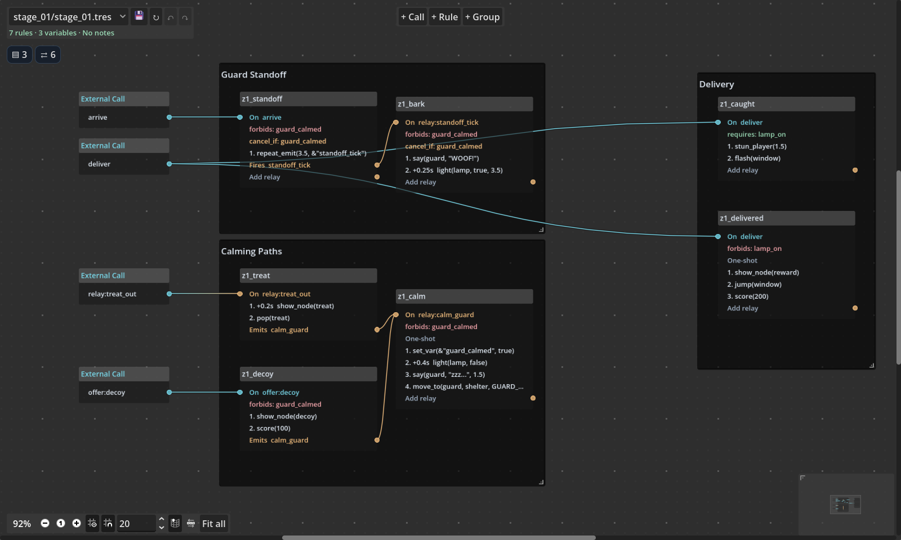
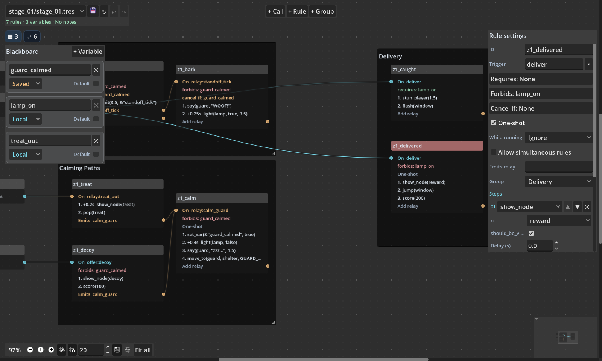
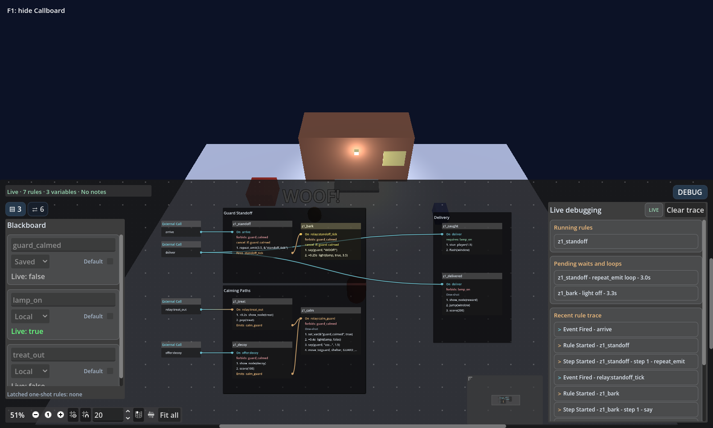

# The Duck Stops Here

## Run the demo

Open [project.godot](../project.godot) in Godot **4.7** and press **F5**. The plugin is already enabled. Open the **Callboard** editor tab and select `stage_01/stage_01.tres` to inspect the same rules that drive the demo. The project includes `res://demo/stages` in `callboard/stage_scan_folders` so the stage picker can find it. CI uses Godot **4.7.2**.

City Hall is expecting a rubber duck, Inspector Biscuit is taking his job very seriously, and the clerk requires a permit for indoor quacking.

1. Offer a decoy at the red shelter or step on the blue biscuit pad to get Inspector Biscuit off duty.
2. Get a squeak permit at the yellow desk. You can do this before or after distracting the inspector.
3. Deliver the duck at City Hall to earn 200 points and meet the new deputy. Try the door early to see what the clerk says when the inspection lamp is on, the inspector is still on duty, or the permit is missing.
4. Stay at the door and deliver the desk bell when its prompt takes over. Try **Reload** between deliveries to see the duck and the count of one restored while the bell is still available.
5. Choose **Switch office** to visit the annex. It uses the same scene with its own permit, deliveries, and one-shot rules. The **Citywide** total carries across both offices.

| Touch or mouse | Keyboard | Action |
| --- | --- | --- |
| Drag anywhere in the play area | **WASD** or **arrow keys** | Move |
| Tap the action button when it appears | **E** | Interact with a nearby prop |
| Tap **Callboard** | **F1** | Toggle the live Callboard when available |
| Tap **Reload** | **R** | Reload the Stage and reset local variables |
| Tap **Switch office** | — | Switch between City Hall and the annex |
| Tap **Start fresh** | **X** | Reset both offices, the shared total, and the score |

The movement stick appears under your finger or mouse and follows as you drag. After your first drag, the stick hides whenever you release it. On a touchscreen, hold the stick with one finger and tap the bottom-center action button with another.

Select `give:gift` and toggle **Isolate** in Callboard to follow delivery routing. Both targets send the same Call with a typed String `gift_id`. The delivery rules check `payload.gift_id`, then the `gift_delivered` relay carries that field to the matching receipt. In the live **Calls & relays** panel, fire `give:gift` without a payload to see the missing-field rule. Trying the door before you qualify fires `give:refused`. With the lamp on, the graph flashes one of two windows that share a mesh and asks the game manager to stun the courier through `gameplay_event`.

| Example | Where to follow it |
| --- | --- |
| Context prompts and external writers | In [Stage 01's scene](stages/stage_01/stage_01.tscn), compare the overlapping **DeliveryArea** and **BellArea** priorities. Each [gift target](scripts/props/gift_target.gd) declares and writes its own saved flag. **BumpPad** declares its local relay latch the same way. |
| Numeric updates and shared state | On `give:gift`, each matching rule uses `add_var` for the saved `gifts_delivered` count and shared `citywide_deliveries` total. The office completion rule checks `gifts_delivered >= 2`. |
| Staging verbs and re-entry | The guard loop drives a timed light. The calming paths converge on `calm_guard`, which moves Biscuit to a marker and plays his nap. Tap the permit desk rapidly to queue extra stamp requests. Each queued stamp starts after a short step delay. The bell receipt rotates the bell upright. |
| Managed stages and restoration | The [game manager](scripts/game_manager.gd) loads each office by stable ID, keeps the other office dormant, and binds listeners before activation. Inspect **Restoration Bindings** on [Stage 01's definition](stages/stage_01/stage_01.tres) to see how the saved flags restore both gifts, the permit, and Biscuit's marker and animation pose. |

The [annotated stage script](stages/stage_01/stage_01.gd) shows how to expose scene nodes to the graph and build the biscuit and decoy at scene markers. Press **F1** during play and open **DEBUG** to see rule activity, queued permit requests, and waits. Open **Blackboard** to see each variable's scope and most recent writer. The store lives in the running demo, so closing the game resets the offices.

## Inspect the graph

See the delivery rule settings and live debugger

To see cancellation in the debugger, start fresh, wait for a guard tick, then offer the decoy. Follow the calming relay and the guard loop stopping at its next cancellation check.

## Run the demo tests

Run these commands from the project root after a Godot import.

~~~sh
godot --headless --path . --script res://demo/tests/editor_smoke.gd
godot --headless --path . --script res://demo/tests/smoke.gd
~~~

See the [Callboard addon guide](../addons/callboard/README.md) for installation, authoring, and runtime setup.
